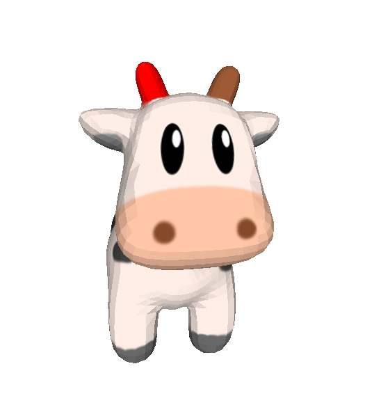
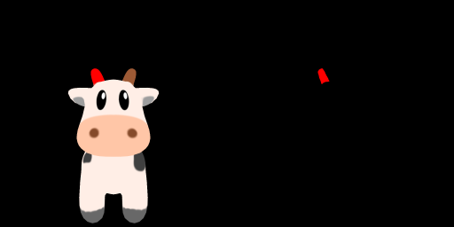
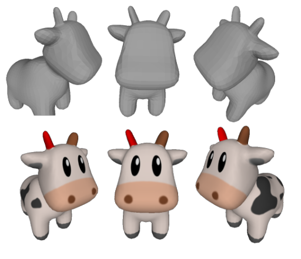
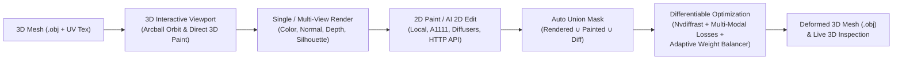
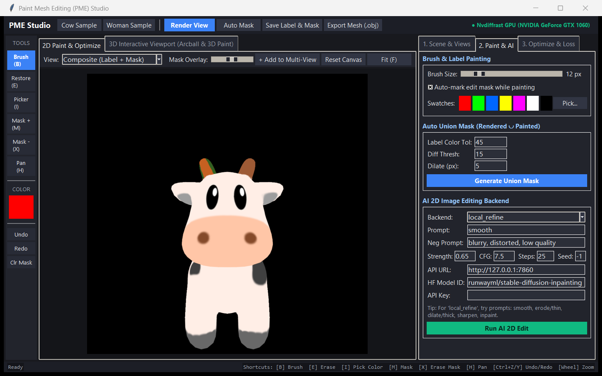
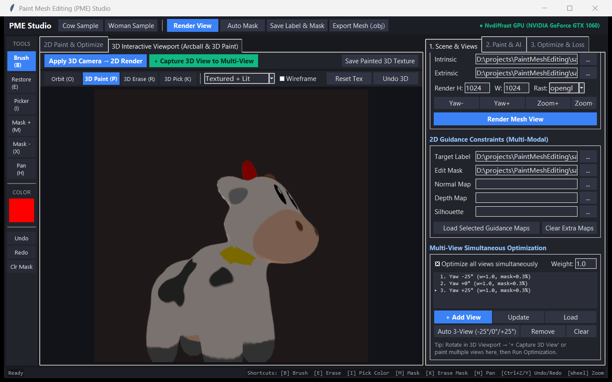
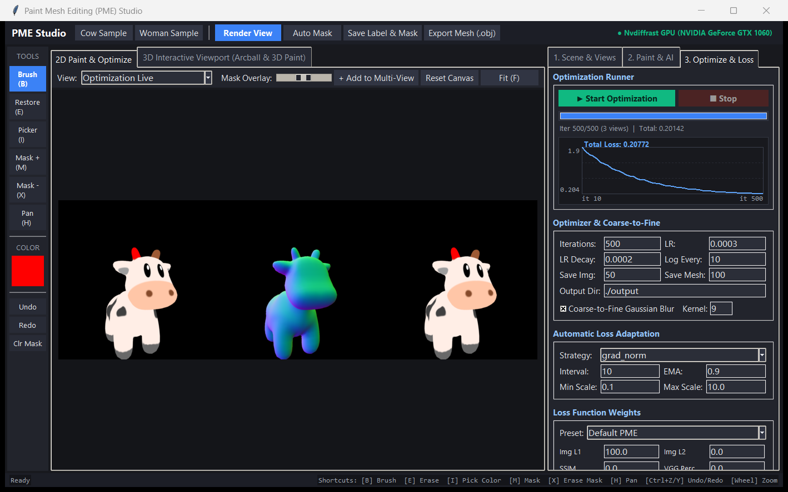

# Paint Mesh Editing (PME)

__PME (Paint Mesh Editing)__ deforms 3D meshes directly from 2D image guidance using differentiable rendering (`nvdiffrast`) and an interactive desktop Studio UI.

## Overview

When you have a 3D mesh, paint part of its texture (or rendered 2D view) with a color label, edit that 2D view manually or with a 2D AI image-editing model, and PME optimizes the 3D mesh vertices to fit the target 2D edit while preserving geometric smoothness and local details.

Here is the classic cow example where the right horn is painted red:



In the rendered view, we thin the red label to make the cow's right horn thinner:



The optimization mask is the union of the rendered label and the painted label. PME then optimizes the mesh vertices to fit the target:



### End-to-End Pipeline



---

## Features & Implemented Capabilities

- **Interactive Studio GUI (`run_gui.py` / `gui/`)**:
  - One-click sample presets (`Cow Sample`, `Woman Sample`) and custom `.obj` / texture / camera loaders.
  - **2D Paint & Optimize Workspace**: Brush, Restore/Eraser, Eyedropper color picker, Mask Brush/Eraser, Zoom/Pan, Undo/Redo, translucent mask overlay, **Auto Union Mask** (`rendered_label ∪ painted_label ∪ diff_pixels`), multi-view inspector, live loss chart, and `.obj` export.
  - **3D Interactive Viewport (`gui/viewport3d.py`)**:
    - Real-time gimbal-lock-free **Arcball Rotation** (Left-drag in Orbit mode or Right-drag anytime), Pan (Middle-drag), and Dolly Zoom (Mouse Wheel).
    - **Direct 3D Mesh Surface Painting**: paint/erase directly onto the 3D mesh surface via visible Face-ID hit-testing + barycentric UV interpolation, with live UV texture updates, 3D Undo, shading modes (`Textured (Unlit)`, `Textured + Lit`, `Normal Shading`, `Clay Lit`), wireframe toggle, and one-click sync to 2D rendering or Multi-View capture.
    - Automatic post-optimization vertex sync so you can immediately orbit and inspect the deformed 3D mesh.
  - **Multi-View Simultaneous Camera Optimization**:
    - Register, edit, weight, and switch between multiple camera viewpoints directly in the GUI (including one-click `Auto 3-View (-25°/0°/+25°)` turntable generation and `+ Capture 3D View to Multi-View`), then jointly optimize all views simultaneously in `PaintMeshEditing.optimize_multiview()`.
  - Automatic fallback to a lightweight CPU software preview renderer when CUDA/`nvdiffrast` is unavailable, so you can still inspect, orbit, paint in 2D/3D, and prepare edits on CPU-only machines.
- **Automatic Loss Adaptation (`core/adaptive_loss.py`)**:
  - `fixed`: Static user-configured weights.
  - `ema_scale`: Magnitude-calibrated EMA weight balancing with smooth regularization decay.
  - `grad_norm`: GradNorm-inspired periodic vertex-gradient norm balancing (`||∇_V (w_i L_i)||_2`).
  - `dwa`: Dynamic Weight Average adapting weights from relative loss convergence rates.
- **Multi-Modal 2D Constraints (`core/editing.py`, `render/ulit_renderer.py`)**:
  - **Color / Label Map** (`label_image`) with optional coarse-to-fine Gaussian blur (`USE_BLUR`).
  - **Normal Map** (`normal_image`, `.npy` float or RGB image) with L1 + cosine similarity loss.
  - **Depth Map** (`depth_image`, `.npy` float or 16-bit/8-bit PNG) with masked L1 + spatial gradient loss.
  - **Silhouette Mask** (`silhouette_image`) with antialiased differentiable soft IoU + L1 loss.
- **Expanded Loss Functions (`util/losses.py`)**:
  - *2D Guidance*: Image L1 (`img_loss`), Image L2/MSE (`img_l2_loss`), differentiable SSIM (`ssim_loss`), VGG-16 Perceptual (`vgg_loss`), Normal Map (`normal_loss`), Depth Map (`depth_loss`), Silhouette (`silhouette_loss`).
  - *3D Regularization*: Relative Vertex & Face Normal Consistency (`nc_loss`), Edge Length Preservation (`edge_loss`), Face Area Preservation (`area_loss`), Uniform Laplacian (`lap_loss`), Detail-Preserving Differential Laplacian (`diff_lap_loss`), and Vertex Displacement Anchor (`disp_loss`).
- **Pluggable AI 2D Image Editing (`core/ai_editor.py`)**:
  - `local_refine`: Zero-dependency offline OpenCV morphological / bilateral / inpaint refinement.
  - `a1111_api`: Automatic1111 Stable Diffusion WebUI REST API (`/sdapi/v1/img2img`).
  - `diffusers_inpaint`: Local HuggingFace `StableDiffusionInpaintPipeline`.
  - `diffusers_instruct_pix2pix`: Local HuggingFace `StableDiffusionInstructPix2PixPipeline`.
  - `custom_http_api`: Generic JSON REST endpoint (`{image_b64, mask_b64, prompt, ...}`).

---

## Dependencies

Core dependencies:
* `torch` & `torchvision`
* `nvdiffrast` (required for GPU differentiable rendering & optimization)
* `numpy`
* `opencv-python`
* `Pillow`
* `tqdm`
* `tkinter` (bundled with standard Python)

Optional (only for local HuggingFace Diffusers 2D AI editing):
* `diffusers`, `transformers`, `accelerate`

```bash
pip install -r requirements.txt
```

---

## Quick Start: Interactive Studio GUI

Launch the interactive GUI from the repository root:

```bash
python run_gui.py
# Or load a sample preset immediately on startup:
python run_gui.py --sample cow
python run_gui.py --sample woman
```

### Studio UI Showcase

#### 1. 2D Paint, Auto Union Mask & AI 2D Editing
Paint target edits directly on the rendered view with translucent mask overlays, build the union mask in one click, or run pluggable 2D AI image-editing backends (`local_refine`, `a1111_api`, `diffusers_inpaint`, `diffusers_instruct_pix2pix`, `custom_http_api`):



#### 2. 3D Interactive Viewport (Arcball Orbit & Direct 3D Mesh Painting) + Multi-View Manager
Inspect and rotate meshes smoothly with gimbal-lock-free Arcball controls, paint labels directly onto the 3D surface (mapped to the UV texture in real time), and capture multiple camera poses for simultaneous multi-view optimization:



#### 3. Multi-Modal Optimization, Live Loss Curve & Adaptive Loss Balancing
Configure 2D guidance & 3D geometry regularization losses, pick an automatic loss adaptation strategy (`fixed`, `ema_scale`, `grad_norm`, `dwa`), and monitor live side-by-side optimization previews (Render | Normal Map | Target) with a real-time loss chart:



### Typical GUI Workflow

1. **Load Scene (`1. Scene & Views` tab or Top Bar)**
   - Click **Cow Sample** or **Woman Sample**, or pick your own `.obj`, texture, `intr.txt`, and `extr.txt`.
   - Optionally attach extra guidance maps (**Normal Map**, **Depth Map**, **Silhouette**).
   - Click **Render Mesh View**.
2. **Optional: 3D Arcball Orbit & Direct 3D Mesh Painting (`3D Interactive Viewport` tab)**
   - Orbit the mesh freely with **Arcball Rotation** (Left-drag in Orbit mode `O`, or Right-drag anytime), Middle-drag to pan, and Mouse Wheel to zoom.
   - Switch to **3D Paint (`P`)** or **3D Erase (`R`)** to paint labels directly onto the 3D surface (updates the UV texture in real time!).
   - Click **Apply 3D Camera → 2D Render** to send the pose & painted texture to the 2D canvas, or click **+ Capture 3D View to Multi-View** from several angles to build a multi-view constraint set.
3. **Paint or AI-Edit 2D Target (`2. Paint & AI` tab + Left Tool Strip)**
   - Use **Picker (`I`)** to sample a label color from the mesh, then **Brush (`B`)** to repaint/reshape it, or **Restore (`E`)** to erase back to the original render.
   - Or select an **AI 2D Image Editing Backend** (`local_refine`, `a1111_api`, `diffusers_inpaint`, `diffusers_instruct_pix2pix`, `custom_http_api`), enter a prompt, and click **Run AI 2D Edit**.
   - Click **Auto Mask** (or **Generate Union Mask**) to build the union mask of the rendered and painted regions, or refine it directly with **Mask + (`M`)** / **Mask - (`X`)**.
   - For multi-view editing, manage viewpoints in **Multi-View Simultaneous Optimization** (`+ Add View`, `Update`, `Load`, `Auto 3-View (-25°/0°/+25°)`).
4. **Configure Losses & Optimize (`3. Optimize & Loss` tab)**
   - Choose a **Loss Preset** (`Default PME`, `Detail-Preserving`, `Multi-Modal`, `Perceptual`) or tune individual loss weights.
   - Select an **Automatic Loss Adaptation** strategy (`fixed`, `ema_scale`, `grad_norm`, `dwa`) and optionally enable **Coarse-to-Fine Gaussian Blur**.
   - Click **▶ Start Optimization** (automatically optimizes all registered views simultaneously when `≥ 2` views are in the Multi-View list), monitor the live preview and loss curve, inspect the deformed result back in the **3D Interactive Viewport**, and click **Export Mesh (.obj)**.

### GUI Keyboard Shortcuts

| Shortcut | Action |
| :--- | :--- |
| `B` / `E` / `I` | 2D Brush / Restore Erase / Eyedropper |
| `M` / `X` | Paint Mask / Erase Mask |
| `H` / Right-Drag (2D) | Pan 2D Viewport |
| `O` / `P` / `R` / `K` | 3D Orbit / 3D Paint / 3D Erase / 3D Color Pick |
| Right-Drag / Middle-Drag (3D) | 3D Arcball Orbit / 3D Pan |
| `Mouse Wheel` | Zoom (2D) / Dolly (3D) |
| `F` | Fit 2D Image to Window |
| `Ctrl+Z` / `Ctrl+Y` | Undo / Redo |

---

## Python API Usage

### 1. Differentiable Rendering

```python
import numpy as np
from util.obj_io import load_obj
from render.ulit_renderer import NvdiffrastMeshUlitRenderer

args = {
    'device': 'cuda',
    'rastype': 'opengl',
    'render_size': (1024, 1024),  # H x W
}

mesh = load_obj(mesh_path, texture_path, 'cuda')
renderer = NvdiffrastMeshUlitRenderer(args)
renderer.set_camera_intrinsic(intrinsic)
renderer.set_camera_extrinsic(extrinsic)

# Returns dict: color, mask, silhouette (antialiased), depth, and optional normal
render_result = renderer(mesh, render_normal=True)
```

### 2. Multi-Modal Optimization with Adaptive Loss Balancing

```python
from core.editing import PaintMeshEditing
from util.obj_io import save_obj

pme = PaintMeshEditing({
    'iteration': 1000,
    'lr': 3e-4,
    'display_image': False,
    'USE_BLUR': True,
    'BLUR_KERNEL_SIZE': 9,
    'adaptive_mode': 'grad_norm',  # 'fixed' | 'ema_scale' | 'grad_norm' | 'dwa'
    'adapt_interval': 10,
    'loss_weights': {
        'img_loss': 100.0,
        'ssim_loss': 15.0,
        'normal_loss': 10.0,
        'depth_loss': 10.0,
        'silhouette_loss': 40.0,
        'nc_loss': 10.0,
        'edge_loss': 100.0,
        'area_loss': 100000.0,
        'diff_lap_loss': 25.0,
        'disp_loss': 1.0,
    },
})

pme.optimize(
    mesh,
    label_image=label,
    mask_image=mask,
    renderer=renderer,
    normal_image=normal,        # optional
    depth_image=depth,          # optional
    silhouette_image=silhouette # optional
)
save_obj('./output/deformed.obj', mesh)
```

### 3. Multi-View Simultaneous Optimization

```python
from core.editing import PaintMeshEditing, ViewConstraint

views = [
    ViewConstraint(
        intrinsic=intr_front,
        extrinsic=extr_front,
        label_image=label_front,
        mask_image=mask_front,
        weight=1.0,
        name='front',
    ),
    ViewConstraint(
        intrinsic=intr_side,
        extrinsic=extr_side,
        label_image=label_side,
        mask_image=mask_side,
        silhouette_image=sil_side,
        weight=1.0,
        name='side',
    ),
]

pme = PaintMeshEditing({'iteration': 1000, 'adaptive_mode': 'grad_norm'})
pme.optimize_multiview(mesh, views=views, renderer=renderer, out_dir='./output')
```

### 4. 2D AI Image Editing Integration

```python
from core.ai_editor import AIImageEditor

editor = AIImageEditor()
edited_bgr, updated_mask = editor.edit(
    rendered_bgr,
    mask_gray=mask_u8,
    backend='a1111_api',                 # or 'local_refine', 'diffusers_inpaint', 'diffusers_instruct_pix2pix', 'custom_http_api'
    prompt='make the horn thinner and smoother',
    endpoint='http://127.0.0.1:7860',
    strength=0.65,
)
```

---

## Project Structure

```text
PaintMeshEditing/
├── core/
│   ├── editing.py          # Multi-modal PaintMeshEditing optimizer
│   ├── adaptive_loss.py    # Automatic loss weight adaptation (EMA / GradNorm / DWA)
│   └── ai_editor.py        # Pluggable 2D AI image editing backends & union mask builder
├── gui/
│   ├── app.py              # PME Studio Tkinter GUI application (2D + 3D + Multi-View)
│   ├── canvas.py           # Interactive 2D paint / mask / zoom-pan / live preview canvas
│   ├── viewport3d.py       # 3D interactive viewport (Arcball orbit & direct 3D UV painting)
│   ├── loss_chart.py       # Real-time loss curve widget
│   └── preview_renderer.py # Nvdiffrast GPU renderer + CPU software preview fallback
├── render/
│   └── ulit_renderer.py    # Differentiable unlit mesh renderer (color, silhouette, depth, normal)
├── util/
│   ├── losses.py           # 2D guidance & 3D mesh regularization losses
│   ├── mesh.py             # Mesh data structure
│   ├── mesh_util.py        # Normals, edges, connected faces, Laplacian, area/length
│   ├── obj_io.py           # OBJ / MTL / texture reader & writer
│   └── vis_util.py         # Normal & depth visualization utilities
├── run_gui.py              # GUI launcher entry point
├── editing_test.py         # CLI optimization example
└── render_test.py          # CLI rendering example
```

## Speed

For the given sample, on an RTX 3070 each optimization run takes less than one minute.

## Roadmap / TODOs

- [x] GUI support (`run_gui.py` + `gui/` Studio UI)
- [x] Automatic loss adaptation (`fixed`, `ema_scale`, `grad_norm`, `dwa`)
- [x] Support more than label constraints (Normal map, Depth map, Silhouette constraints)
- [x] More loss functions (L2, SSIM, VGG perceptual, Differential Laplacian, Vertex Displacement, Normal/Depth/Silhouette losses)
- [x] Combination of other AI models for 2D image editing (Local refine, Automatic1111 WebUI API, Diffusers Inpaint / InstructPix2Pix, Custom HTTP API)
- [x] Multi-view simultaneous camera optimization (`PaintMeshEditing.optimize_multiview` + GUI Multi-View Manager)
- [x] 3D interactive viewport with real-time arcball rotation & direct 3D mesh painting (`gui/viewport3d.py`)
